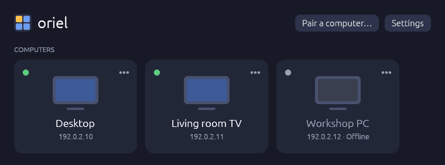
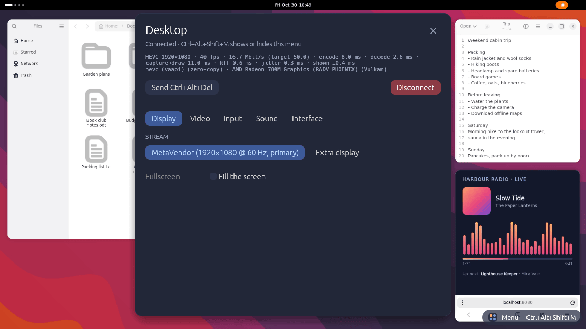

# oriel

oriel is a low-latency remote desktop written in Rust, for using your own
computers from your other computers and phones: at home over the LAN, or from
elsewhere through an optional hub. It's quick enough for games as well as
desktop work. A single `oriel` binary is both the host, which shares a
display, and the client, which connects to one.





## What it does

oriel streams the host's screen as HEVC, H.264 or AV1 (encoded on the GPU
where possible) over QUIC, and sends keyboard, mouse, touch, gamepad and microphone input back. The
client draws the host's cursor with its own OS cursor, so pointing feels local
even with some latency, and switches to relative mouse input when a game
captures the cursor. Sound, the clipboard (text and images), multiple
displays, per-session resolution changes and using the client as an extra
virtual monitor all work. The bitrate follows what the network can carry, and
the client explains a slow stream while it happens (packet loss, jitter, a
host that can't keep up).

[PyroWave](https://github.com/Themaister/pyrowave), an intra-only wavelet
codec for fast LANs, is supported experimentally (`--codec pyrowave`, or
`--codec auto` to fall back to HEVC when the link can't carry it).

[docs/usage.md](docs/usage.md) goes through the session features, settings,
the Windows service and the Android app in detail.

## Components and platforms

- `oriel` (crates/oriel) is the desktop app and CLI. Without arguments it
  opens the start window shown above, where you pair with and connect to
  computers, and share this one.
- Hosts run on Windows (Desktop Duplication, encoding with NVENC, AMF, Quick
  Sync or Media Foundation via FFmpeg) and on Linux under GNOME (Mutter's
  remote desktop API and PipeWire, VAAPI encoding). On Windows, an installer
  sets oriel up as a service, so the sign-in, lock and UAC screens can be
  shared too, with a tray app to control it.
- Clients run on Linux (Wayland and X11), Windows and macOS.
- The Android app (`android/` and crates/oriel-android, Android 9+) is a
  client with touch controls and an on-screen keyboard, and can also share
  the phone's screen.
- The hub (crates/oriel-hub) is an optional server for logging devices in
  to an account and relaying connections that can't be made directly.

## Pairing and connecting

Devices only talk to devices they have paired with. To pair, the host shows a
six-digit PIN ("Allow pairing" in the app, or `oriel host --pair`) and you type
it into the client. The PIN is used for a SPAKE2 exchange that pins both
devices' certificates, so later connections need no PIN and a man in the
middle can't take part. Sessions run over a single QUIC connection on UDP port
48600.

With a hub, you log each device in once instead (Settings → App → Account,
through your OpenID Connect provider), and every device under the account can
reach every computer shared under it. Clients try the host's known and
reported addresses first and fall back to relaying through the hub. The hub
only forwards encrypted packets; it never sees the stream. See
[docs/hub.md](docs/hub.md).

## Getting started

Build it (see below), then on the computer you want to reach:

```sh
oriel host --pair            # prints a PIN; allow UDP 48600 in the firewall
```

and on the client:

```sh
oriel pair <host-address> --pin <PIN>
oriel connect <host-name>    # or just run `oriel` for the start window
```

`oriel connect --help` lists options such as `--fullscreen`, `--stats` and
`--codec`. `oriel hosts`, `oriel clients`, `oriel forget` and `oriel unpair`
manage pairings, and `oriel info` shows this device's identity, encoders,
displays and config directory.

On Windows, `scripts/package-windows.sh` builds an installer that sets up the
hosting service and the tray app; see [docs/usage.md](docs/usage.md#windows-installer-and-service).

## Configuration

Everything is in the app's Settings: one set of defaults, which each computer
can override (from its tile's ⋯ menu, or from the menu during a session). The
settings are stored in `client.toml` in the config directory, for example:

```toml
bitrate_kbps = 50000
max_fps = 120
codecs = ["hevc", "h264"]

[hosts.my-desktop]   # overrides for one computer
max_fps = 144
```

## Running a hub

The hub is published as a container image, `ghcr.io/fruitiex/oriel-hub`. It
serves its API over HTTP on port 8080, behind your own reverse proxy. Relaying
is optional and uses a UDP port of your choice, which has to be reachable from
the internet. It is configured with environment variables, the main ones
being:

```sh
ORIEL_HUB_OIDC_ISSUER=https://id.example.com
ORIEL_HUB_OIDC_CLIENT_ID=oriel
ORIEL_HUB_OIDC_CLIENT_SECRET=...
ORIEL_HUB_RELAY_BIND=0.0.0.0:48700
ORIEL_HUB_RELAY_PUBLIC=hub.example.com:48700
```

The full list is at the top of `crates/oriel-hub/src/main.rs`. Push wake-ups
for Android phones are optional and need a Firebase service account.

## Building

Everything builds in the Nix dev shells:

```sh
nix develop
cargo build --release -p oriel          # Linux client and host
./scripts/build-windows.sh --release    # Windows build in dist/windows
./scripts/package-windows.sh            # Windows installer and portable ZIP in dist/
./scripts/package-macos.sh              # on a Mac: oriel.app and a ZIP in dist/
nix build                               # Nix package
nix build .#hub-container               # hub container image

nix develop .#android
./scripts/build-android.sh [--install]  # debug APK in dist/
```

## Development

```sh
cargo test --workspace
oriel host --test-pattern               # a host that needs no real display
```

[docs/architecture.md](docs/architecture.md) explains the protocol, pacing and
the capture and encoding paths. [AGENTS.md](AGENTS.md) has development notes,
including how to test without real hardware.

## License

MIT or Apache-2.0, at your option, see [LICENSE-MIT](LICENSE-MIT) and [LICENSE-APACHE](LICENSE-APACHE).
